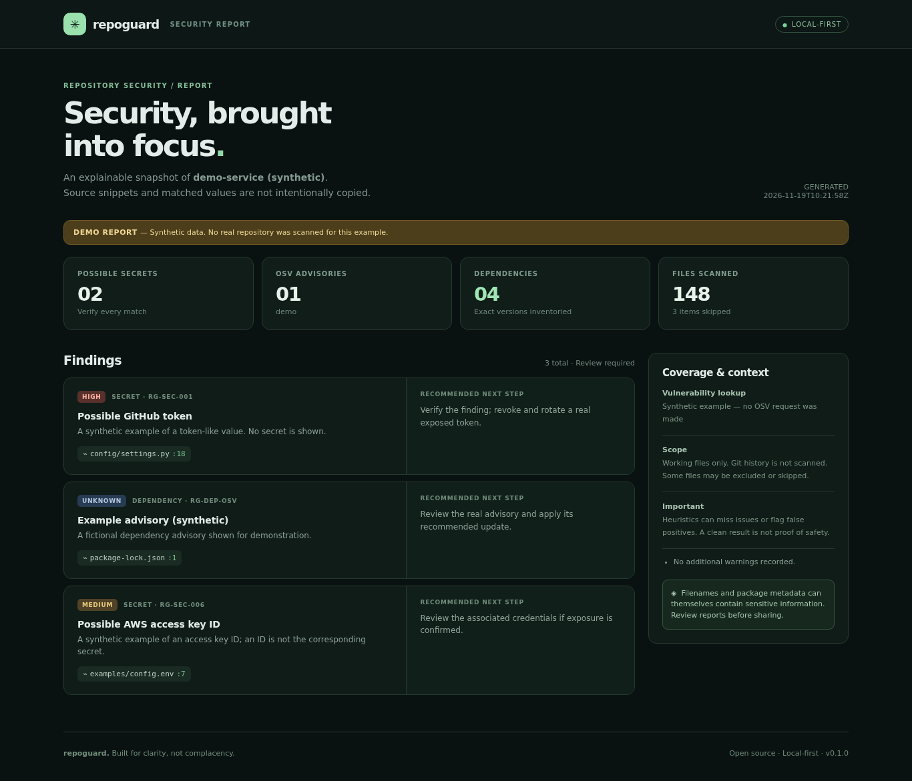

# RepoGuard

**A local-first, explainable first look at repository security.** RepoGuard looks for certain credential patterns in working files, inventories selected exact dependency versions, and can check those versions against [OSV.dev](https://osv.dev/). It produces actionable reports without deliberately copying matched source lines or credential values.

[Français](README.fr.md) · [Website](https://mindcompta.github.io/repoguard/) · [Synthetic report demo](https://mindcompta.github.io/repoguard/demo/) · [Security policy](SECURITY.md)



> **Scope matters:** this is an early, limited security aid, not a full security audit. Findings can be false positives; issues can be missed. An empty report is **not** proof a project is safe. Verify every finding and review the coverage notes.

## What it does

- Checks UTF-8 working files with 10 explainable rules covering some GitHub, GitLab, Slack, Stripe, npm and AWS credential patterns, private-key markers, generic credential assignments, and passwords in connection URLs. An AWS access key ID is not the corresponding secret key.
- Optionally queries OSV for exact npm and PyPI versions found in supported files. Advisory results link to OSV; this version does **not** assess severity, determine exploitability, or automatically choose a fix.
- Produces standalone HTML, text, JSON and SARIF 2.1.0 reports. Each finding includes a location, explanation and a recommended next step.
- Defaults to a **local, read-only** scan: it does not execute the scanned project, send its source code, modify its files, or contact OSV unless explicitly requested. Writing a report is an explicit exception to read-only operation.
- Requires Python 3.10+ and has no third-party **runtime** dependencies.

## Quick start

```bash
git clone https://github.com/mindcompta/repoguard.git
cd repoguard
python3 -m repoguard scan /path/to/your-project
```

Create an offline HTML report, preferably outside the scanned project:

```bash
python3 -m repoguard scan /path/to/your-project --format html -o ~/repoguard-report.html
```

Open that file in a browser. To preview the design without scanning a project or making a network request:

```bash
python3 -m repoguard demo --format html -o ~/repoguard-demo.html
```

The demo is explicitly labelled **synthetic**. For an installed `repoguard` command, run `python3 -m pip install .` from this repository; installation may download build tools. On Windows, replace `python3` with `python` if needed.

### Optional: check dependencies with OSV

```bash
python3 -m repoguard scan /path/to/your-project --osv --format html -o ~/repoguard-osv-report.html
```

**Opt-in disclosure:** `--osv` sends the **package names, ecosystems and exact versions** that RepoGuard inventories to `https://api.osv.dev/v1/querybatch`. It does not send file contents, source snippets, file paths, or matched credential values as such. Package coordinates themselves can be sensitive, and OSV and network intermediaries can observe connection metadata such as your IP address. Do not enable it if this disclosure is inappropriate for your project. OSV results can be incomplete or outdated; a failed or incomplete query is shown as partial, not as clean.

## Commands and exit codes

```text
repoguard scan [directory] [--format text|json|html|sarif] [-o FILE]
               [--osv] [--exclude GLOB] [--respect-inline-ignores]
               [--fail-on none|low|medium|high] [--force]
repoguard demo [--format text|json|html|sarif] [-o FILE] [--force]
```

- Without `-o`, the report goes to standard output; operational notices go to standard error. Existing output files are not overwritten without `--force`. New files use restrictive permissions where supported. Leaf symlinks are refused for output; `--force` is unavailable on platforms without the necessary no-follow protection. Directory components of the output path may still be symlinks.
- If the output file is inside the scan directory, it is excluded from that scan. Reports can still expose sensitive **filenames, project names and package metadata**. In unusual cases a secret may itself be part of a filename or dependency coordinate. Review and protect reports before sharing or uploading them.
- `--exclude` is repeatable and matches a relative path or a file/directory basename using shell-style globs; quote patterns so your shell does not expand them. Excluded directories are not descended into.
- Inline `repoguard:ignore` markers are **ignored by default**: they do not suppress findings unless you explicitly pass `--respect-inline-ignores`. With the flag, any line containing the marker is skipped (the tool does not parse comment syntax), and the report warns about it. Do not trust suppressions supplied by untrusted contributors.
- By default findings do **not** cause failure. `--fail-on` opts into a severity threshold. Dependency advisories have **unknown** severity and count as high for threshold purposes, conservatively; review the linked advisory rather than treating this as an assessment.

| Exit | Meaning |
| --- | --- |
| `0` | The scan finished within its configured scope and the selected threshold was not reached. This does not mean the project is secure. An OSV status of `no_supported_dependencies` means nothing was checked. |
| `1` | At least one finding reached the requested `--fail-on` threshold. |
| `2` | Invalid input/output, a file scan stopped or was incomplete because of a read error or limit, or an explicitly requested OSV check/inventory was incomplete. Exit `2` takes precedence over `1`. |

For example, generate a SARIF file and fail CI on medium-or-higher findings:

```bash
python3 -m repoguard scan /path/to/your-project --format sarif \
  -o ~/repoguard.sarif --fail-on medium
```

Uploading SARIF to GitHub or another service is a separate, deliberate disclosure; review the report's paths and other metadata first. A SARIF result for an npm lockfile points to **line 1**, not the exact JSON entry.

## Coverage and limitations

### Dependency inventory

| File | What is inventoried |
| --- | --- |
| `requirements*.txt`, or `.txt` files inside a `requirements/` directory | Exact `package==version` pins; extras and environment markers are accepted, but markers are **not evaluated**. Non-exact pins, includes, hashes and unsupported syntax are skipped with a warning. |
| `package-lock.json` | npm lockfile versions 1–3, including nested dependencies where a supported name and version are available. Local links, some aliases, unsupported versions, and non-registry/workspace cases may be omitted with a warning. Location is line 1. |

Other formats (including Yarn, pnpm, Poetry, uv, Pipfile, Go, Cargo, Maven and Composer) are not inventoried. Common unsupported manifests and lockfiles are reported as incomplete; unknown formats may not be detected. A `package.json` without a `package-lock.json` in the same directory is flagged; `package.json` itself is never parsed for the inventory. A successful OSV response covers only inventoried coordinates, never the full dependency universe. Duplicate/alias advisories may describe the same issue.

### File scan

Only the current working files are examined: **Git history, commits, branches not checked out, archives, files detected as binary and non-UTF-8 files are not analyzed**. Binary detection is heuristic. Common generated/vendor directories such as `.git`, virtual environments, `node_modules`, `vendor`, `dist` and `build` are skipped, as are nested symbolic links. Git-ignored files are otherwise scanned. Limits include 2 MiB per file, 20,000 file entries, 1,000 secret findings per file, 10,000 report findings, 5,000 dependencies per supported file and 10,000 inventory entries. OSV requests are limited to 1,000 unique coordinates, 100 per batch, five pages per coordinate, 10,000 advisory matches and 4 MiB per response. Relevant limits and read failures produce coverage warnings and an incomplete status.

Pattern-based secret checks do not validate whether a credential is active, cannot detect every provider or value, and can miss weak or placeholder-like generic passwords. They may flag examples or test data. If a real credential was exposed, **revoke or rotate it first**, then remove it from files and history and assess the incident; rewriting history alone does not revoke a credential.

## Development

```bash
python3 -m unittest discover -s tests -v
python3 -m repoguard --help
```

Tests use synthetic values and mock network failures and pagination. The GitHub workflow runs the suite across supported Python versions. See [CONTRIBUTING.md](CONTRIBUTING.md) and [SECURITY.md](SECURITY.md).

## License

[MIT](LICENSE). RepoGuard is an independent project; the name is also used by other projects.
